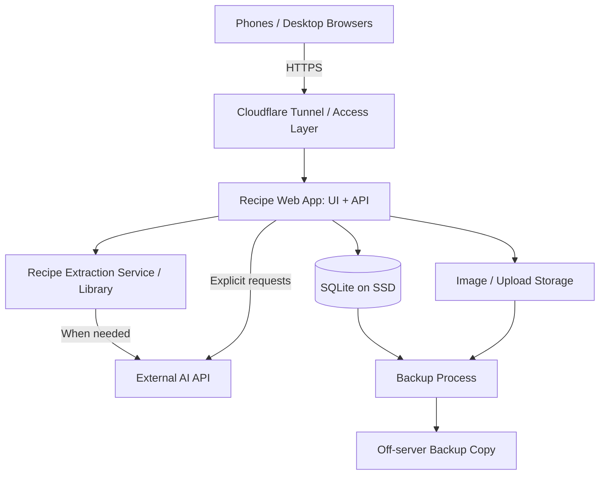
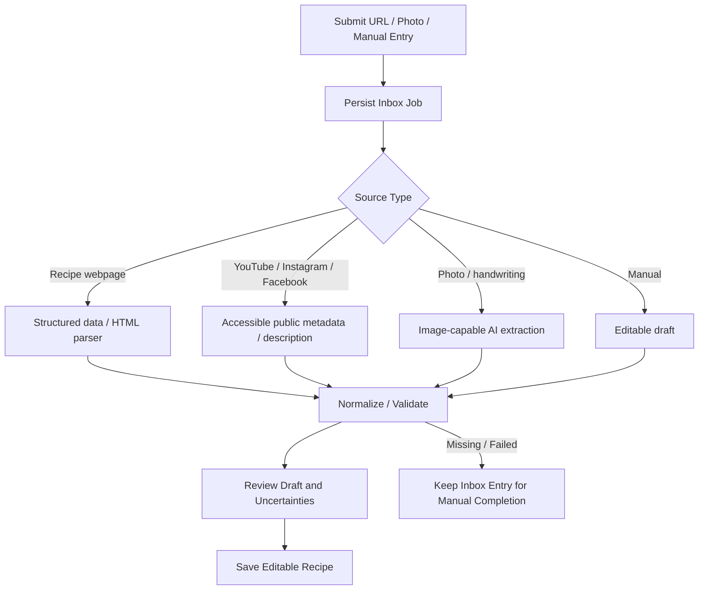

# Technical Design

## 1. Architecture goals

- Self-host on existing Ubuntu Server 24.04 using Docker Compose.
- Keep infrastructure small, maintainable, and inexpensive.
- Support one shared household workspace, access by two household members, and 1,000+ recipes.
- Provide secure remote HTTPS access without exposing the database or opening router ports.
- Use paid AI only for explicit requests and difficult imports.
- Preserve data portability and recoverability.

## 2. Proposed high-level architecture



**Proposed deployment:** one application container (frontend assets + backend), one tunnel container, and a backup job. No Redis, message broker, or separate database server is initially necessary. The exact frontend/backend framework is **not finalized**.

## 3. Technology decision record

| Layer | Candidate | Decision / rationale |
|---|---|---|
| Server | Existing Ubuntu Server 24.04 | Selected; reuses current hardware. |
| Orchestration | Docker Compose | Selected; consistent with existing services. |
| App/API | Python FastAPI | Proposed; useful for parsing, uploads, AI and structured API endpoints. |
| Frontend | React + Vite + Tailwind | Proposed; good mobile interactions, but assess whether a simpler server-rendered frontend is sufficient. |
| Simpler alternative | FastAPI + Jinja2/HTMX | Evaluate before implementation to reduce build complexity and JavaScript maintenance. |
| Database | SQLite | Selected provisionally; sufficient for household scale. Enable WAL and busy timeout. |
| ORM/migrations | SQLAlchemy + Alembic | Proposed if using FastAPI. |
| Images | Filesystem with database references | Selected; avoids binary storage in SQLite. |
| Website extraction | schema.org/JSON-LD parsing with guarded HTTP fetching | Implemented for the initial importer without another scraping dependency; unsupported sites remain manual drafts. |
| AI | OpenAI Responses API | Server-only key; configurable `gpt-6-luna` default with centralized pricing and structured text/image outputs. |
| Remote access | Cloudflare Tunnel | Proposed; validate domain, account, and access requirements. |
| Source control | GitHub | Selected for code and documentation; not production database storage. |

## 4. Application modules

1. **Access boundary:** explicit local-development bypass; production Cloudflare Access JWT verification and household scoping.
2. **Recipes:** CRUD, categories, structured ingredients, ordered steps/tips, photos, cooking history.
3. **Search:** SQLite indexed queries and optional FTS5 for title, ingredient, and tag text.
4. **Imports:** inbox, source URL/photo storage, deterministic extraction, AI fallback, validation and review.
5. **Meals on Deck:** shared unordered meal selection, per-entry servings, cooked status, and explicit completed-item clearing.
6. **Groceries:** deterministic ingredient scaling/aggregation, staple exclusions, manual overrides, purchase states, preview-and-apply updates.
7. **AI assistant:** narrowly scoped actions for photo extraction, substitutions, recipe ideas, and contextual cooking help.
8. **Settings/export:** household staples, backup/export access, account settings.

## 5. Proposed data model

Identifiers should be stable UUIDs or database-generated IDs; timestamps should be stored in UTC. The following is a conceptual schema, not final DDL.

| Table | Key fields / relationships |
|---|---|
| `users` | Legacy compatibility only; application email/password accounts are no longer required. |
| `households` | `id`, `name` (optional abstraction for shared data) |
| `household_members` | `household_id`, `user_id`, `role` |
| `recipes` | `id`, `household_id`, `title`, `description`, `status`, `base_servings`, `yield_unit`, `prep_minutes`, `cook_minutes`, optional additional-time minutes/label, source metadata, image path, timestamps |
| `recipe_ingredients` | `id`, `recipe_id`, `position`, `ingredient_id` nullable, `display_text`, `quantity_value`, `unit`, `preparation`, `optional` |
| `ingredient_measurements` | `id`, `recipe_ingredient_id`, `position`, `quantity`, `unit`; optional alternatives only, while the recipe ingredient retains the primary measurement and package detail |
| `ingredients` | `id`, `canonical_name`, `normalized_name`, optional aliases |
| `recipe_steps` | `id`, `recipe_id`, `position`, `instruction_text`, `tip_text` nullable |
| `recipe_tags` | `recipe_id`, `tag_id` (meal type and custom tags) |
| `recipe_proteins` / `proteins` | Multi-select standardized protein-source classifications; the legacy recipe protein column remains for data compatibility |
| `tags` | `id`, `name`, `type` |
| `import_jobs` | `id`, `household_id`, `source_type`, `source_url`, status, title, draft payload, error, duplicate/saved recipe references, timestamps |
| `import_assets` | `id`, `import_job_id`, persistent storage name, original name, page order, media type, timestamp |
| `deck_entries` | `id`, `household_id`, `recipe_id`, `servings`, `cooked_at`, `position`, timestamps |
| `cooking_events` | `id`, `recipe_id`, `user_id`, `cooked_at` |
| `pantry_staples` | `id`, `household_id`, `ingredient_id` or normalized name |
| `grocery_lists` | `id`, `household_id`, `updated_at` (one current snapshot per household) |
| `grocery_items` | `id`, `grocery_list_id`, `label`, normalized name, quantity, unit, category, checked/manual flags, generated source key, position |
| `grocery_excluded_staples` | `id`, `grocery_list_id`, staple name and normalized name for the current snapshot |

**Important modeling choices:**

- Keep original ingredient display text as well as parsed quantities to avoid losing nuance.
- Store equivalent printed measurements separately from package sizing. Imports prefer weight, then volume, then count as the primary without inventing conversions; grocery aggregation uses only that primary measurement.
- Ingredient names should be normalized for search/aggregation, with manual correction possible.
- Recipe steps store an optional tip on the same step, not a detached notes collection.
- Total time is derived from prep, cook, and additional time. Structured source totals contribute only an unaccounted remainder so they are not double-counted.
- The grocery list is a **persisted snapshot**, not a live projection of the lineup. This enforces manual refresh.
- Grocery item states should distinguish `needed`, `already_have`, and `purchased`; manual exclusions must not be confused with purchases.
- Track `created_by` and `updated_by` where useful for shared editing/auditing.

## 6. Ingredient scaling and grocery aggregation

### Scaling

- Each recipe has `base_servings`.
- Each deck entry stores its own `servings`.
- `scaled_quantity = base_quantity * (deck_servings / base_servings)` for numeric quantities.
- Do not automatically scale temperatures, cooking durations, or nonnumeric phrases such as “to taste.”
- Preserve fractions/decimal precision in calculations; format quantities for display.

### Aggregation

1. Collect ingredients for all unfinished deck entries.
2. Scale quantities for each entry.
3. Normalize ingredient names and compatible units (e.g., oz/lb where appropriate).
4. Group only when ingredient identity and unit semantics are compatible.
5. Exclude fixed pantry staples by default; allow manual inclusion.
6. Present ambiguous combinations separately (e.g., “1 onion” vs “1 cup chopped onion”) rather than guessing.
7. Save the resulting grocery list only after explicit confirmation.

### Manual refresh semantics

- Changing Meals on Deck never automatically mutates the existing grocery list.
- “Update Grocery List” computes a **proposed diff** (additions, quantity changes, removals).
- Preserve manual items, already-have decisions, purchased states, and user-edited quantities unless the user explicitly accepts changes.
- Use a revision number/optimistic concurrency check to avoid one household member silently overwriting another's edits.
- Show conflicts for review rather than silently discarding user changes.

## 7. Recipe import pipeline



- Save the inbox entry before making network or AI calls.
- Use deterministic webpage extraction first; only invoke AI when requested/necessary.
- For social sources, public metadata and descriptions vary by platform and post; never claim universal caption or transcript extraction and never bypass access restrictions.
- URL imports select Schema.org Recipe images first, then Open Graph/Twitter thumbnails, then a guarded primary-image fallback. Selected JPEG/PNG/WebP files are SSRF-checked, size/image validated, and persisted as Inbox cover assets before becoming recipe photos.
- Facebook share URLs may resolve to public Reel/video pages, but the unauthenticated page often exposes only title/description metadata and a thumbnail—not video frames, audio, subtitles, or a transcript. Metadata-only content must remain a manual-review failure rather than a fabricated AI recipe.
- Extracted Inbox drafts may retain an unspecified yield as `null`; saved recipes still require a positive yield amount because serving scaling and grocery calculations depend on it. A missing yield is resolved by the reviewer, never by an invented default.
- YouTube AI imports inspect public player caption tracks without downloading video. English manual captions are preferred, followed by English auto-captions and then other public tracks; chronological caption text is combined with the public description and sent through the existing budgeted AI extraction path. Missing, blocked, failed, and empty caption responses remain distinct review states, and users may paste transcript text as a fallback.
- Full pasted transcripts are accepted up to 200,000 characters through the same structured extraction path. For a copied YouTube page, content before the `Search transcript` boundary and redundant timestamp display lines are omitted from the AI request while the original pasted text remains unchanged in the browser. Browser, reverse-proxy, and provider timeouts are aligned for long-running extraction; provider timeouts, rate limits, unreadable responses, malformed structured output, and output-limit truncation are mapped to distinct retryable messages without logging transcript text or secrets.
- Optional recipe component sections are stored in `recipe_sections` with independent ingredient/instruction kinds and ordered nullable references from ingredient and step rows. Existing rows remain unsectioned. API responses retain flat ordered ingredient/step arrays for compatibility while adding ordered section lists and per-item `section_index` assignments. AI extraction uses this same contract for web, social, transcript, pasted-text, and image sources; explicit source components and chapter labels such as preparing a crust or making a filling become ordered sections without forcing groups onto simple recipes.
- For cookbook photos, accept multiple pages and preserve page order; show original image alongside editable extraction.
- Limit upload size/type; validate MIME types, strip unsafe filenames, and store outside public static directories.
- Avoid fetching arbitrary internal/private URLs supplied as recipe links: enforce SSRF protections (block loopback, private IP ranges, redirects into internal networks, etc.).
- Respect source licensing and access controls; retain attribution and do not bypass paywalls or platform restrictions.
- Validate model output against a strict schema; flag uncertainty instead of fabricating missing details.
- The initial implementation persists the job before running bounded extraction in the request process. Status and retry data are durable; a separate task queue is unnecessary at household scale and can be introduced later if import latency requires it.
- YouTube, Instagram, and Facebook importing reads only publicly returned structured metadata/descriptions. It does not download video content or bypass authentication, transcript, or access restrictions.
- Original cookbook/handwritten images are retained with the Inbox item for manual transcription until that item is explicitly deleted. No vision extraction is implied without a configured AI provider.

## 8. AI integration and cost controls

AI should be invoked only for explicit user actions:

- Parse cookbook/handwritten page images.
- Structure difficult accessible recipe text.
- Suggest ingredient substitutions or adapt a recipe.
- Generate new dishes using ingredients on hand.
- Answer questions about the currently opened recipe.

**Controls:** server-side API keys; per-request input limits; no key or prompt logging; strict JSON-schema output validation; confirmation before saving generated or extracted recipes; and clear errors if the service is unavailable. Never use AI for normal search, recipe scaling, pantry exclusions, or grocery calculations.

The application records monthly estimated cost in integer microdollars. Each request atomically reserves a conservative feature-specific amount before calling the provider, then replaces the reservation with token-based cost when usage is reported. Missing usage and provider failures are charged at the reservation amount. New reservations are refused when spend plus reservations would exceed $10; the UI warns at $8. Calendar-month keys provide automatic monthly rollover. This reduces concurrency overspend but cannot guarantee an exact provider-billing hard cap, so provider-side limits remain recommended.

## 9. UI architecture

**Navigation:** Home, Recipes, Dinner Lineup, Grocery List, Add/Inbox (final ordering to be validated in mockups). Help Me Pick and What Can I Make are prominent home actions.

**Core screens:**

- Home: search, a few shortcuts, current lineup, compact recipe suggestions.
- Library: search, filters, cuisine browsing, compact recipe cards.
- Recipe: small image, metadata, serving selector, ingredients, steps with tips, optional cooking mode, edit action.
- Add/Inbox: quick URL/photo entry, pending/failed imports, review editor.
- Meals on Deck: unordered dinner cards, servings, cooked status, completed-item clearing, and Help Me Pick.
- Grocery List: categorized editable items, `already_have` vs `purchased`, explicit update preview.
- Help Me Pick: rotation/forgotten/new/mix selection and ingredient/time filters.

**Visual design:** warm cream, olive/sage, warm brown; serif display headings; legible body text; compact imagery; ample whitespace; minimal competing controls. Mobile first, responsive desktop second. Support accessible touch targets and keyboard use.

## 10. Security and remote access

- Local development may bypass identity only when `auth_mode=local` is explicitly configured.
- Production validates Cloudflare Access signed JWT assertions using the configured issuer keys and application audience. Missing or invalid assertions fail closed.
- Enforce verification and household scope for every API operation; never rely only on frontend visibility or an unverified email header.
- Put the application behind HTTPS. Cloudflare Tunnel is a candidate for remote access without router port forwarding; a domain under Cloudflare management is generally required for a stable named hostname.
- Cloudflare Tunnel alone does **not** authenticate users. Cloudflare Access provides the production identity gate, and the backend independently verifies its signed assertion.
- Bind the app to internal Docker networking or localhost as appropriate; do not expose SQLite or AI keys publicly.
- Use least-privilege container permissions, pinned image versions, input validation, and routine dependency updates.
- Restrict uploads and URL fetching to avoid malicious files and SSRF.

## 11. Deployment and storage

Illustrative layout (verify actual mounts, permissions, free space, and backup locations first):

```text
/paulwall/discoball/docker/our-kitchen/
  compose.yaml
  .env                  # server-only secrets; gitignored
  app/                  # source or built image configuration

/var/lib/our-kitchen/
  recipes.sqlite3       # active DB on SSD, subject to capacity check

/paulwall/discoball/data/our-kitchen/
  images/
  uploads/
  exports/
  backups/              # local staging only, not sole backup
```

Docker volumes/bind mounts must persist the SQLite database and media across deployments. Configure WAL mode, busy timeout, transaction handling, and one controlled migration process. Avoid copying a live SQLite file without a consistent backup mechanism.

## 12. Backup and recovery

- Run scheduled consistent SQLite backups (SQLite backup API or `VACUUM INTO`, not an unsafe live file copy).
- Back up image/upload files alongside database snapshots.
- Retain multiple versions and keep at least one backup **off the server** (different device or location).
- Periodically test restoring a backup into a temporary environment.
- Keep GitHub for source and documentation; do not commit live databases, uploaded cookbook photos, or API secrets.

## 13. Delivery plan

| Phase | Deliverables |
|---|---|
| 0. Validate stack | Choose React/FastAPI vs simpler server-rendered approach; confirm storage and hostname/security. |
| 1. Foundation | App foundation, access boundary, database schema/migrations, mobile design system. |
| 2. Recipe core | CRUD, photo upload, tags, search, cooking views, direct edits. |
| 3. Inbox/import | URL capture, structured extraction, review flow, manual fallback. |
| 4. Planning/groceries | Shared lineup, serving scaling, fixed staples, grocery snapshot, safe manual refresh. |
| 5. AI and extended imports | Cookbook photos, YouTube when available, What Can I Make, new recipe generation, substitutions. |
| 6. Remote deployment | Tunnel/HTTPS, security hardening, backups, phone usability tests. |

Remote access may be enabled earlier for household testing once authentication and HTTPS are secure; the phases are not strict deployment dependencies.

## 14. Testing and acceptance

- Unit tests for scaling, unit conversion, staple exclusions, and grocery merge conflicts.
- Import tests for valid, partial, failed, and duplicate sources; multi-photo order and uncertainty flags.
- Authorization tests proving users cannot access data outside the intended household.
- Mobile tests for recipe reading, step mode, checkboxes, and grocery shopping interactions.
- Two-device tests for shared edits and concurrent grocery-list updates.
- Backup restore test; server restart persistence test; AI-unavailable fallback test.
- Confirm normal library and grocery workflows work without an AI API key.

## 15. Open architecture decisions

1. Select final web stack after a small UI prototype: React/FastAPI or server-rendered FastAPI + HTMX.
2. Revalidate the selected OpenAI model and pricing table before changing models.
3. Define the Cloudflare Access email allow-list and session policy before deployment.
4. Choose the remote hostname/domain and validate tunnel configuration.
5. Finalize ingredient canonicalization, unit handling, and grocery conflict UI.
6. Verify SSD/HDD free space, permissions, and off-server backup target.
7. Confirm first-release scope for cookbook photo and YouTube imports.

## 16. Explicit non-goals

No Kubernetes, dedicated PostgreSQL/Redis infrastructure, automatic pantry inventory, day-based calendar scheduling, offline sync, public social recipe platform, or paid WhatsApp messaging integration in the initial design.
